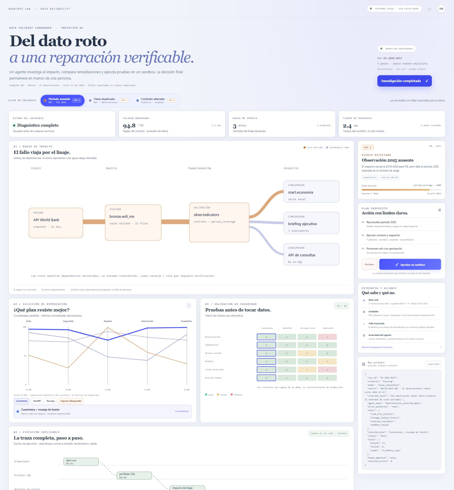

# Data Incident Commander

Agente de IA supervisado para **respuesta a incidentes de datos**. Recorre un
incidente determinista de principio a fin: diagnostica el linaje afectado,
compara remediaciones, ejecuta validaciones y se detiene para pedir una
**aprobación humana** antes de simular la reparación sobre una copia temporal.

[](https://github.com/Dev-HugoAguilar/data-incident-commander/actions/workflows/tests.yml)
[](https://www.python.org/)
[](#servicio-de-dominio)

> **Alcance.** Flujo determinista con reglas y *fixtures* explícitas. No usa LLM,
> no requiere credenciales, no escribe en bases de datos ni en sistemas externos
> y no se presenta como un producto de producción.

La demo funciona con un servidor de archivos estático. El servicio de dominio se
ejecuta con la biblioteca estándar y sirve para inspeccionar, probar y auditar el
mismo comportamiento que muestra la interfaz.

---

## Qué demuestra

- **Diagnóstico con evidencia**: cada afirmación se ancla a una validación con
  identificador, resultado y detalle, no a una narración libre.
- **Autoridad acotada**: el agente propone; la persona aprueba. La imputación
  simple está fuera de la lista permitida y la interfaz la marca como
  **no aprobable**.
- **Reparación sin efectos**: aprobar simula la reparación en memoria y devuelve
  un recibo (`RCPT-…`); rechazar termina sin efecto. La fuente nunca se modifica,
  y el digest del archivo se publica para poder comprobarlo.
- **Trazabilidad**: el Sankey de dependencias, la matriz de validaciones y la
  traza por carriles describen qué se revisó, en qué orden y con qué resultado.

## Demo local

```bash
git clone https://github.com/Dev-HugoAguilar/data-incident-commander.git
cd data-incident-commander
python -m http.server 8000 --directory web
```

Abre <http://127.0.0.1:8000/>. No hay paso de compilación, ni gestor de paquetes,
ni variables de entorno: la aplicación es HTML, CSS, JavaScript y un JSON.



## Servicio de dominio

El paquete `src/app` replica el espacio de nombres del backend del portafolio,
de modo que la sincronización entre ambos sea una copia directa y revisable.

## Instalación

El paquete de dominio se instala en el entorno activo; requiere Python 3.11 o
superior.

```bash
python -m venv .venv
.venv\Scripts\activate            # Windows · en Linux/macOS: source .venv/bin/activate
python -m pip install -e .        # con pytest: python -m pip install -e ".[dev]"
python examples/uso.py            # incidente completo con aprobación simulada
python -m pytest -q
```

`python -m pip install -e .` deja `app` importable desde cualquier directorio y ya
no depende de la opción `pythonpath` de pytest (que se conserva para poder correr
las pruebas sin instalar). `examples/uso.py` inyecta la falla en una copia en
memoria: no escribe en el repositorio ni en sistemas externos.

**Demo estática (`web/`) frente a servicio de dominio (`src/`).** `web/` es la
aplicación que se sirve con un servidor de archivos estático: HTML, CSS y
JavaScript leen `web/data.json` y reproducen el flujo sin Python ni instalación.
`src/app` es el servicio de dominio: escenarios, validaciones, runs efímeros,
aprobación humana y recibos. Instalar solo es necesario para usar `src/app` como
biblioteca o para correr las pruebas.

```bash
python -m pip install -r requirements-dev.txt
python -m pytest
```

`pyproject.toml` configura `pythonpath = ["src"]`, así que las pruebas importan
`app.*` sin necesidad de instalar nada. Ocho pruebas cubren el snapshot, los tres
escenarios, los planes permitidos, el bloqueo de la imputación, la idempotencia
de la aprobación, los errores de dominio y la integridad del archivo fuente.

### Uso directo

```python
from app.config import Settings
from app.incident_commander.service import IncidentCommander

app = IncidentCommander(Settings())
run = app.crear_run("missing")          # inyecta la falla en una copia
print(run["status"])                     # awaiting_human

recibo = app.aprobar(run["run_id"], approved=True, plan_id="quarantine")
print(recibo["status"], recibo["receipt"])
# sandbox_simulation_completed RCPT-…
```

## Escenarios

Cada escenario inyecta una falla **solo en una copia en memoria**. No son
incidentes reportados por el Banco Mundial ni defectos del snapshot original.

| Escenario | Falla inyectada | Regla que falla | Filas en la copia |
|---|---|---|---|
| `missing` | Falta el PIB de 2025 | `period_coverage` | 20 |
| `duplicate` | Tres filas repetidas de PIB 2023 | `key_uniqueness` | 24 |
| `schema` | `indicator_code` cambia de tipo en PIB 2024 | `catalog_codes` / `known_indicators` | 21 |

El snapshot fuente conserva **21 observaciones reales** de World Development
Indicators para México, 2019–2025, con año, código de indicador, valor, unidad y
enlace de origen. El escenario recomendado por el flujo es `quarantine` en los
tres casos: aislar el dato dudoso antes de reconstruirlo.

## Remediaciones y autoridad

| Plan | Efecto en el sandbox | Aprobable |
|---|---|---|
| `quarantine` | Aísla las filas afectadas | Sí |
| `backfill` | Repone el periodo faltante | Sí |
| `fullreload` | Recarga completa desde el origen | Sí |
| `forward` | Imputa el valor anterior | **No** |

Las puntuaciones de 0 a 100 en las coordenadas paralelas son **hipótesis
comparativas del escenario**, no métricas observadas en producción. El Sankey
representa dependencias declaradas, no volumen de filas.

## Estructura

```text
web/                        Aplicación estática (sin compilación)
  index.html                Estructura y contenido editorial
  styles.css                Sistema visual
  app.js                    Flujo del incidente y renderizado SVG
  data.json                 Snapshot WDI · 21 observaciones
src/app/config.py           Configuración sin secretos ni rutas absolutas
src/app/incident_commander/ Escenarios, validaciones, runs y recibos
examples/uso.py             Ejemplo ejecutable del incidente completo
tests/test_service.py       Pruebas del dominio sin red ni base de datos
docs/ARCHITECTURE.md        Límites de autoridad y flujo de datos
docs/DATA.md                Fuente, licencia y límites del snapshot
docs/cover.jpg              Captura real de la demo servida
```

La capa HTTP se publica por separado, en el repositorio de infraestructura
`portfolio-api`. Este repositorio contiene la aplicación y el servicio de
dominio; el contrato es estable y está descrito en
[`docs/ARCHITECTURE.md`](docs/ARCHITECTURE.md).

## Límites

- Flujo determinista con reglas y *fixtures*; no hay LLM ni autonomía productiva.
- Las puntuaciones y reglas describen el escenario de demostración, no producción.
- El estado es efímero: al reiniciar el proceso no quedan runs ni recibos.
- La aprobación no escribe en archivos, bases de datos ni sistemas externos.
- El snapshot es un extracto de una fuente pública; no es una serie económica
  completa ni sirve para tomar decisiones de política.

## Datos y atribución

World Development Indicators (Banco Mundial), México, 2019–2025, bajo
**CC BY 4.0**. Licencia y condiciones de la fuente en [`docs/DATA.md`](docs/DATA.md).
Este repositorio no incluye un archivo `LICENSE` propio: se respetan únicamente
las condiciones de las fuentes citadas.

## Contribuir y seguridad

Convenciones de código, mensajes de commit y flujo de revisión en
[`CONTRIBUTING.md`](CONTRIBUTING.md). Para reportar un problema de seguridad, usa
los avisos privados descritos en [`SECURITY.md`](SECURITY.md).
